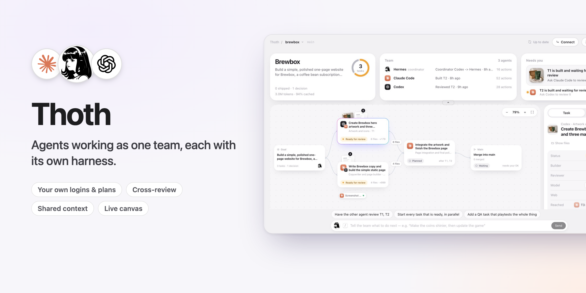
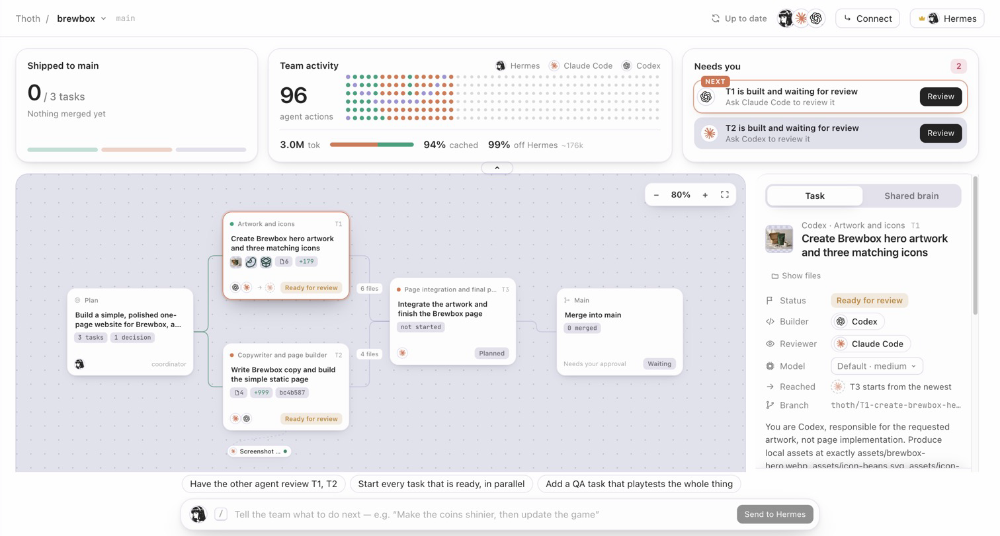
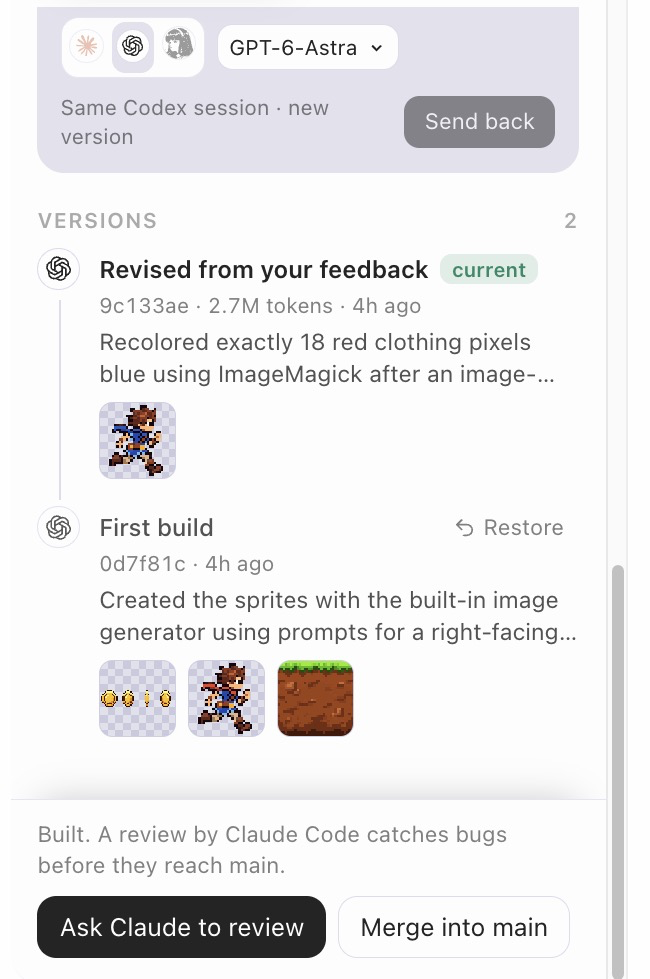
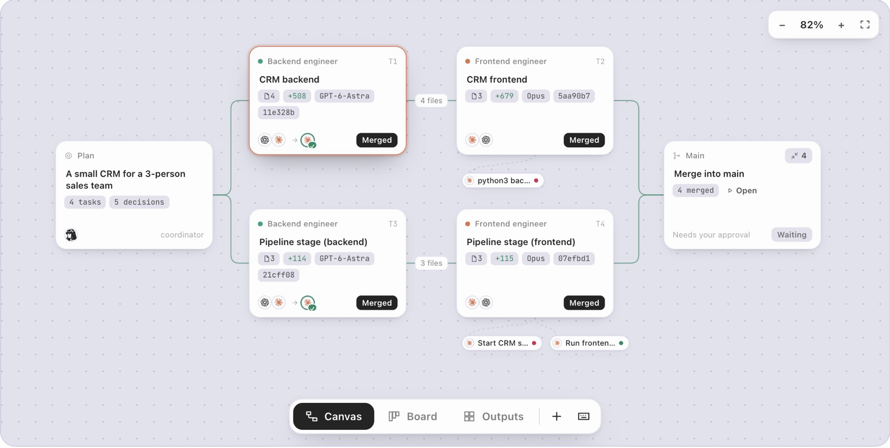
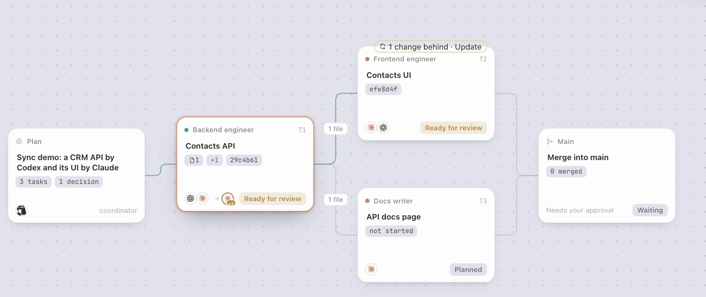
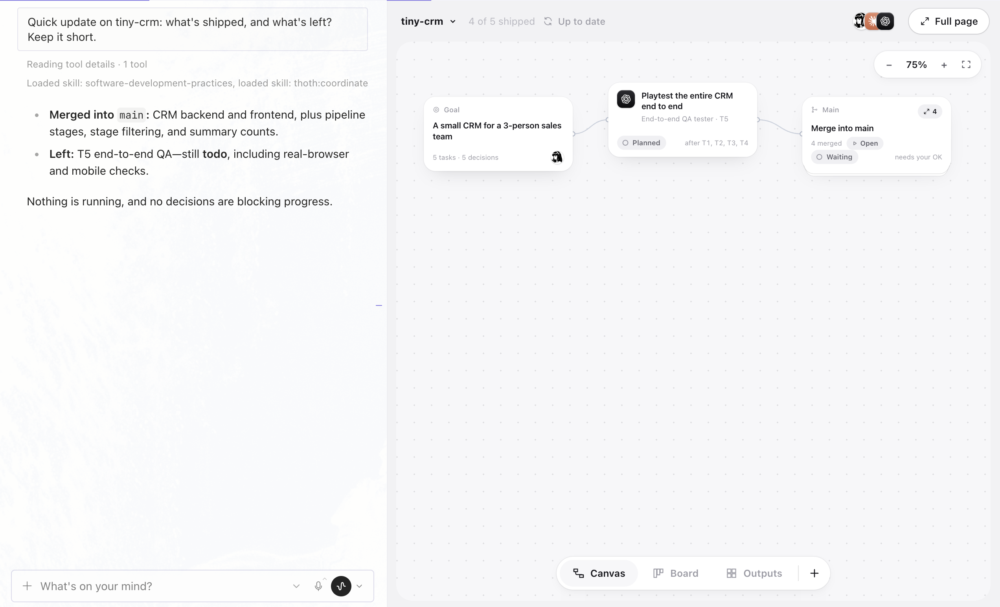
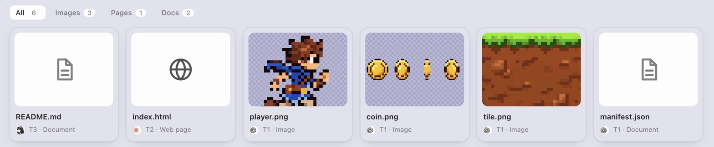

# Thoth — agents working as one team, each with its own harness



You use Claude Code, Codex and Hermes. Each is good at different things, but on their own they work
alone: you carry context from one to the other by hand, and they overwrite each other's files when
they share a project.

**Thoth makes them one team, and each agent keeps its own harness.** Hermes plans the work onto a
shared board and gives each task to the agent that suits it. The **real** Claude Code and Codex build
side by side, each in its own git worktree, on your own logins and plans. Each reviews the other's
work, and Hermes merges what passes. What one agent decides or makes goes into the next one's brief,
so nobody copy-pastes.

**Why their own harness.** Anthropic, OpenAI and Nous keep making Claude Code, Codex and Hermes
better: new tools, sandboxes, sub-agents and models. Thoth doesn't swap them for one generic wrapper,
so each improvement reaches your team the day it ships. Nothing is locked in either: connect Claude
Code or Codex to the same board (one click on the Thoth page), keep working in it directly, and it
picks up where the team is. It can even take over as coordinator.

Today the team is Claude Code, Codex and Hermes. Next we want to bring more agents that ship their own
harness onto the same board, such as Grok Bot, Muse, Antigravity and DeepSeek Harness.



```
                ┌──────────────── Hermes (coordinator) ────────────────┐
   you ──▶      │  thoth_plan → thoth_assign → thoth_wait → thoth_review │
                └───────┬──────────────────────────────┬───────────────┘
                        │ brief from the brain          │
             ┌──────────▼─────────┐          ┌──────────▼─────────┐
             │  Claude Code CLI   │          │     Codex CLI      │
             │ worktree T1, branch│          │ worktree T2, branch│
             └──────────┬─────────┘          └──────────┬─────────┘
                        │  decisions, handoffs (MCP)     │
                        └──────────▶  .thoth/brain  ◀────┘
                           goal · board · decisions · notes · runs · versions
```

## What it does

| Problem | What Thoth does |
|---|---|
| Agents don't share context | Every run starts with a **brief built from the brain**: goal, board, team decisions, handoffs, review comments and what dependencies produced. Agents write decisions back through the bundled MCP server while they work. |
| No shared progress | A **task board** (todo → running → built → reviewing → approved/changes → merged) with live progress of every running agent. |
| Agents overwrite each other | Each task gets its **own git branch and worktree**, so Claude Code and Codex can work at the same time. |
| No versions | Every run's result is a **commit** on its task branch; merges are `--no-ff` merge commits; the timeline records which agent made which commit. |
| One agent checks its own work | **Cross-review**: the other agent reviews the diff read-only and returns approve/changes with comments. Re-assigning a task resumes the original agent's session with the review comments in its brief. |
| Stuck with one coordinator | `thoth_coordinator` hands the coordinator role to Claude Code or Codex; they drive the same board through the Thoth MCP server. |
| Agents can't look at the web | A task can get a **browser**: a clean Chrome without your logins, or your own Chrome when it needs your logins. See [Looking at the web](#looking-at-the-web). |

## Not only code

Tasks have a **kind** (code, asset, doc, research, design, qa) and a **role**, and `depends_on`
passes one task's files to the next. Codex can generate and process images (its image tool plus
ImageMagick), Claude Code builds, and Hermes can take a task itself (`thoth_assign` to `hermes`,
then `thoth_complete`). The Thoth page shows what every agent read, changed and produced (images as
thumbnails), which files moved between tasks, and every sub-agent an agent delegated to.

Not happy with a result? **Send it back** with your words: the same agent continues in its own session
(on another model if you pick one) and makes a new version. Every version stays one click from being
restored.



## Looking at the web

The agents' shells have no network. A task that has to look at websites gets a browser instead, through
Google's Chrome DevTools MCP server. Say Codex should study a client's current site before Claude designs
their sales page:

- **Clean Chrome** (`browser: clean`): a fresh headless Chrome without your logins, deleted after the run.
  Right for public sites.
- **Your Chrome** (`browser: user`): your everyday Chrome with your logins, for pages behind them (your
  store's admin, a private dashboard). Turn on remote debugging once at `chrome://inspect/#remote-debugging`
  (Chrome 144 or newer); Chrome then asks you to allow each run's connection. The agent opens its own
  tab, is told to only look (no posting, buying or changing settings) and closes the tab when it is done.
  It can see the titles of your other tabs, and the approval card says so.

Hermes chooses when it plans, or set it in the task inspector on the Thoth page. Reviews never browse. In
our runs Claude Code studied nousresearch.com in a clean Chrome in 41 s, and Codex did the same in the
user's Chrome in about a minute; both returned a screenshot and the site's real colors and fonts.

## One CRM, built two ways

Codex (GPT-6-Astra) builds the backend, Claude Code (Opus 5.5) builds the frontend, then both add a
pipeline stage to contacts. Same specs, same models, no packages; one run of each.



| | By hand (you pass work between agents) | Thoth, the four builds | Thoth with two cross-reviews and a fix |
|---|---|---|---|
| Prompt tokens | 3.27M | **2.41M (−26%)** | 3.47M |
| Output tokens | 85k | 52k (−39%) | 66k |
| Agent time | 17.2 min | **11.1 min (−35%)** | 15.1 min |
| Frontend calls that work against the backend | 9/9, then 9/9 | 10/10, then 10/10 | |
| Real bugs caught | none (nobody reviewed) | | **2, fixed** — and both were in the by-hand build too |
| Messages you have to relay | 2, and you must know what changed | 0 | 0 |
| Shared memory afterwards | none beyond the code | 5 API decisions, in every later brief | |

What made the difference: Claude's brief already held Codex's summary, its files and the API decisions
it recorded, so nobody pasted anything; each task ran in its own worktree; and Codex reviewing Claude's
frontend found an overlapping-refresh race and an invalid-number-saved-as-zero bug. What did not change:
a follow-up task starts a fresh session, so Claude re-read the backend about as often as it did by hand.

**Who has the newest version.** A task's **Reached** row lists the work built on it: a check when that task
has its newest version, otherwise the version it has ("T2 is on v2 of 3"). The task that fell behind says
**1 change behind · Update** on its card, and Needs you asks for it too; one click (or `thoth_sync`) brings
the newer version in.



## Context, tokens and memory

Measured on real runs (see `thoth_status` → `tokens`, or the Team activity card):

- **The coordinator stays small.** Hermes receives each run's summary, diffstat and verdict, not the
  transcript. On the tip-calculator demo the agents' transcripts were 674 KB; Hermes received 9.6 KB
  (98.6 % kept out, about 166k tokens).
- **Every agent starts focused.** A run gets a 2–18 KB brief (goal, decisions, handoffs, review
  comments, the files its dependencies produced) instead of the whole conversation.
- **Lean workers** (on by default) start agents without your personal plugins, hooks, skills and extra
  MCP servers: one call's fixed prompt drops from 46.8k to 25.2k tokens for Claude Code and from 35.7k
  to 27.1k for Codex. Every call re-sends that prefix, so a 10–30 call run saves 200k–600k tokens.
- **Caching does the rest:** 82–95 % of prompt tokens in our runs were cache hits.
- **Small tool surface:** all 18 Thoth tools add about 2.3k tokens to a coordinator call (3 tools,
  about 300 tokens, for a worker).
- **Memory:** the brain (`.thoth/brain.db`, `BRAIN.md`) keeps goal, decisions, handoffs, reviews and
  versions across sessions and across tools, and re-assigning a task resumes the agent's own session.

What it does not do: total tokens across all agents are not lower than one agent doing everything —
each agent pays its own fixed prompt and cross-review reads the diff again. The gain is that no single
context has to hold everything, the expensive coordinator context stays tiny, and the work is spread
across your Claude and ChatGPT plans.

## Requirements

- Hermes Agent ≥ 0.22.5
- `git`
- [Claude Code](https://docs.claude.com/en/docs/claude-code) (`claude`) and/or [Codex CLI](https://github.com/openai/codex) (`codex`), installed and **logged in**. Thoth uses your existing logins and plans; it never handles their credentials.
- Only for tasks that browse: Node.js 20.19 or newer (`npx`; Hermes's own Node works) and Google Chrome.

## Install

```bash
hermes plugins install thoth                 # from the plugin catalog
hermes plugins install cayden970207/thoth    # or straight from GitHub
hermes thoth doctor                          # checks claude, codex, git and the browser
```

Then open the **Thoth** page in Hermes Desktop's sidebar.

## Use it

Open Hermes in a git project and talk to it:

> Start a Thoth brain for this project: a tip calculator web page. Plan it so
> Claude builds the UI and Codex writes the calculation logic with tests, run
> them in parallel, then have each review the other's work and merge what passes.

Hermes will call the Thoth tools; you approve each agent launch and each merge.

| Tool | What it does |
|---|---|
| `thoth_init` | Create/reopen the brain (`.thoth/`, kept out of git) |
| `thoth_plan` | Add tasks with agent, dependencies and, when they need the web, a browser |
| `thoth_assign` | Start Claude Code or Codex on a task in the background (**needs your approval**) |
| `thoth_wait` | Wait for runs and get summary, commit and diffstat |
| `thoth_review` | Cross-review by the other agent, read-only (**needs your approval**) |
| `thoth_merge` | Merge a task branch into the base branch (**needs your approval**) |
| `thoth_status` / `thoth_context` | Board, live progress, decisions; full brief for a task |
| `thoth_note` | Record a decision / handoff / risk / question for every agent |
| `thoth_preview` | Open what a task built (a web page, a browser game) in your browser, served read-only on localhost |
| `thoth_revise`, `thoth_restore`, `thoth_sync` | Send work back with feedback, bring back an earlier version, pull a dependency's newer version |
| `thoth_cancel`, `thoth_update_task`, `thoth_coordinator` | Stop a run, edit a task, hand over coordination |

For a brand-new project, ask for one: Hermes calls `thoth_init(create=true)` and Thoth makes the folder
and its git repository. A task that depends on several unfinished tasks starts with all of their work
merged into its branch.

**Talk on the left, watch on the right.** Each project has one chat with Hermes, pinned in the sidebar in
the project's colour. Beside it, Thoth docks a side window with the whole canvas (drag the divider to
resize; **Full page** opens the full Thoth page), plus a **Team & brain** tab: the project in numbers
(shipped, decisions, tokens, cache), what needs you, who is on the team, and the shared brain of decisions,
reviews and versions, where a click on an entry opens its task. The team's faces in the side window's header
show who is working and open that tab. The side window follows the chat you are looking at, and what you say
shows up on the canvas as it happens: new tasks appear, a pill shows what Hermes is doing (*Hermes ·
planning tasks*), the tasks its answer mentions light up, and approvals still happen right there in the
chat. Typing on the full Thoth page goes to the same project chat and shows Hermes's answer on the page, so
a project never ends up spread over many chats. **Beside the chat** on the Thoth page opens this layout, and
Hermes's layout picker gets a **Chat + Thoth** template (sessions, the chat, Thoth) to come back to it any
time. The side window sits with the chat, like Hermes's browser, so folding Hermes's files, review and
terminal never hides it. Click a task and a small card rises from the bottom with its status, next step
and action, while the canvas stays in view; **All details** grows it in place, and Esc or a click on the
canvas puts it away. Once the window is wide enough, the details open in a column beside the canvas instead.



**One project, one place in Hermes.** Every Thoth project is also a Hermes project on the same folder. The
first time Thoth shows a project it creates that Hermes project (named after the folder, in the project's
colour, or reuses the one you already have there) and moves the project's chat into the folder, the same as
Hermes's own *Move to project*. Hermes's sidebar then files the project's chats under it, Hermes works in that
folder, and every chat you open there is about that project. The side window follows whichever project the
chat on screen belongs to, and picking a project in Thoth's switcher opens its chat. If the chat on screen is
about something else, a one-line note offers the project's own chat, or starts one. The switcher shows each
project's progress and what waits on you; rename, recolour or archive projects in Hermes's sidebar (an
archived project drops out of the switcher), and **Remove from Thoth** takes one off Thoth's list without
touching its folder.

**Seeing the result.** Every task that made a web page or a browser game gets an **Open preview** button
on the Thoth page (and Hermes has `thoth_preview`). Thoth serves that task's folder on `127.0.0.1`, read-only, never hidden files such
as `.env`. The **Outputs** view collects everything the team made that you can look at — images, video, sound,
web pages and documents — and plays or shows each one in place. On the canvas, shipped work folds into
the Main card once there is more than a little of it (the count in its corner lays it out again), so a long
project stays readable.



For an app with a backend (say a CRM whose server also serves its pages), give the project a run command —
`thoth_init(run="python3 backend/server.py --port {port}")`, approved by you. **Run & open** then starts the
app for the version you are looking at, in a clean copy under `.thoth/previews/`, so the database or logs it
writes never end up in an agent's work or your checkout.

**Dependencies.** A task worktree is a clean checkout, and the agents' sandboxes have no network, so they
cannot reinstall packages. Thoth links ignored `node_modules`, `.venv` and `venv` folders from your main
checkout into each new worktree (agents can read them, not change them; the links are excluded from git).
For a full install per task, give the project a setup command — `thoth_init(setup="npm ci")` — which
Thoth runs in each new worktree before the agent starts, outside the sandbox and only after you approve
it. Thoth never reads or copies `.env` files or other secrets into a worktree.

**Hearing back in chat.** When an agent finishes, Thoth can tell the chat that started it, with one
message for a batch of runs and nothing for results `thoth_wait` already returned. Hermes keeps this off
until you allow it for Thoth:

```yaml
plugins:
  entries:
    thoth:
      allow_gateway_injection: true
```

Without it Hermes learns about finished runs through `thoth_wait`, and the Thoth page shows them anyway.

Slash command: `/thoth [status | task T1 | cancel R1 | coordinator claude|codex|hermes | brain | doctor]`.

### Let Claude Code or Codex coordinate

```
/thoth coordinator claude
```

prints a one-time setup command, e.g.

```bash
claude mcp add thoth -- <hermes python> -I <plugin dir>/mcp_server.py --as claude
```

Then in Claude Code: *"You are the Thoth coordinator. Call thoth_status and continue the plan."*
Claude Code now sees the same board, decisions and history, and can start Codex
(or another Claude Code) through `thoth_assign`. Claude Code's own permission
prompts decide which Thoth tools it may call. Runs started from Claude Code live
as long as that Claude Code session.

### Agents without the MCP server

`.thoth/BRAIN.md` is a readable snapshot of the whole brain, regenerated on every
change, so any tool can catch up by reading one file.

## Settings

Hermes Desktop → Settings → Plugins → Thoth, or `plugins.entries.thoth.settings` in `config.yaml`:
default worker, Claude Code permission mode and extra allowed tools, models, CLI
paths, run timeout (default 30 min), max parallel runs (default 3), whether agents
get the Thoth MCP tools, session resume, worktree cleanup, chat notifications,
environment passthrough.

## What Thoth does on your machine (disclosure)

- **Starts agent CLIs as subprocesses**: `claude -p` and `codex exec` (and `codex exec resume`), in a
  task worktree under `<project>/.thoth/worktrees/`, only after you approve each launch in Hermes.
  They run under **your** Claude Code / Codex login and plan, talk to Anthropic / OpenAI servers,
  and use your usage allowance.
- **Permissions it gives them** (never chosen by a model):
  build runs — Claude Code `--permission-mode acceptEdits` with its OS sandbox on
  (`sandbox.enabled`, `autoAllowBashIfSandboxed`, `allowUnsandboxedCommands: false`: shell commands such
  as tests run without prompts but can only write inside the worktree and temp folders; turn it off
  with `claude_sandbox: false`, after which shell commands are limited to read-only git commands plus
  your `claude_allowed_tools`), Codex `--sandbox workspace-write` (Codex's OS sandbox: writes only
  inside the worktree); review runs — no edit tools for Claude Code, `--sandbox read-only` for Codex.
  Anything a reviewer leaves in the worktree is discarded (`git reset --hard` + `git clean -fd` in that
  task's worktree only) so it can't slip into the next build commit. Thoth never passes any
  "skip permissions" or "bypass sandbox" flag.
- **Pre-approves its own three worker tools inside Codex runs**: `codex exec` cannot ask anyone, so
  the run-scoped Thoth MCP server is started with `default_tools_approval_mode="approve"`. In worker
  mode that server exposes only `thoth_status`, `thoth_context` and `thoth_note` (read the brain,
  write a note); it cannot start agents or touch files.
- **Strips the environment** passed to agents: variables ending in `_API_KEY`, `_TOKEN`, `_SECRET`,
  `_PASSWORD`, and `HERMES_*`, `ANTHROPIC_*`, `OPENAI_*`, `CLAUDE_CODE_*`, `CODEX_*` (except `CODEX_HOME`)
  are removed unless you list them in `env_passthrough`.
- **Writes into your project**: `.thoth/` (SQLite brain, `BRAIN.md`, run logs with the agents' full
  JSON output, worktrees), one line in `.git/info/exclude`, git branches `thoth/T<n>-…`, commits
  authored `Thoth <thoth@localhost>` on those branches, and merge commits on your base branch when
  you approve a merge. In a repository with no commits it makes one empty initial commit.
- **Background processes**: runs continue after the tool call returns, up to the timeout; they are
  killed (whole process group) on cancel, timeout, plugin unload and Hermes exit.
- **Run previews**: with a project run command (approved by you), Thoth exports the version you open to
  `.thoth/previews/` and starts that command there as you, outside the agents' sandbox, on a free localhost
  port. At most 4 apps run at once; they stop when Hermes exits, and leftovers are stopped on the next start.
- **Previews**: when you (or Hermes) open a preview, a static file server listens on `127.0.0.1` on a
  free port for that task's folder, inside the Hermes process. It only answers GET/HEAD and never serves
  hidden paths. At most 8 run at once.
- **Worktree setup**: links ignored dependency folders (`node_modules`, `.venv`, `venv`) from your main
  checkout into new worktrees and adds exact-path lines for them to `.git/info/exclude`; with a project
  setup command (approved by you) it runs that command in the new worktree as you, with network access.
  It never reads or copies `.env` files.
- **Connect buttons** on the Thoth page run, only when you click one, `claude mcp add thoth …` (this project
  only) or `codex mcp add thoth …` (Codex's own config, all projects), so that tool can coordinate through
  the bundled MCP server. Thoth changes no other setting of Claude Code or Codex, and reads neither one's
  login: they sign in on their own.
- **Hermes Desktop layout and chats**: adds two panes (the Thoth side window, docked beside the conversation,
  and Team & brain) and one layout template, **Chat + Thoth**, which changes your layout only when you pick
  it. Closing a pane only hides it, and Layout → Reset brings it back. The first time Thoth sends
  a project's request it opens a chat for that project, then pins that chat and gives it the project's colour,
  once (unpin it and it stays unpinned). For each Thoth project it creates a Hermes project on that project's
  folder (or reuses yours) and moves the project's chat into the folder, through Hermes's own project calls;
  your other projects and chats are left alone. Which chat belongs to which project, and which projects Thoth
  lists, is kept in the plugin's data folder (`chats.json` and `projects.json`: session ids and project paths
  only). Hermes reopens Team & brain beside the side window once per session.
- **Web browsing, only for tasks you give a browser**: the agent's CLI starts `npx -y chrome-devtools-mcp@1.2.0`
  (Google's Chrome DevTools MCP server, downloaded from npm on first use and pinned to that exact version,
  which has no dependencies of its own) with `--no-usage-statistics --no-performance-crux --redactNetworkHeaders`.
  A clean browser is a headless Chrome with a temporary profile, deleted after the run. "Your Chrome"
  (`--autoConnect`) attaches to the Chrome you are running, only while remote debugging is on and only after
  you allow the connection in Chrome; the agent then sees your open tabs' titles and addresses, acts with
  your logins, and is told to only look in a tab of its own. The browser tools are pre-approved inside that
  run (`codex exec` cannot ask), which the run's approval card covers; an "always allow" for runs without a
  browser never covers runs with one. Reviews never get a browser.
- No network calls of its own (the browser package above is fetched by npx when a task first browses), no
  telemetry, no credential reads, no self-updating code.

## Development

```bash
uvx pytest tests            # offline tests (no agent CLIs needed)
hermes plugins validate .   # catalog checks
hermes plugins doctor . --ci
```

`thoth_core/` is plain Python with no third-party dependencies, shared by the Hermes plugin
(`__init__.py`) and the MCP server (`mcp_server.py`).

MIT License.

## Trademarks

The Claude, Codex (OpenAI) and Hermes marks on the Thoth page only identify which tool did what. They come from the
vendors' own packages (Anthropic's Claude Code extension, OpenAI's Codex extension and Hermes Agent's assets) and
remain trademarks of their owners. Thoth is an independent community plugin, not affiliated with Anthropic or OpenAI.
